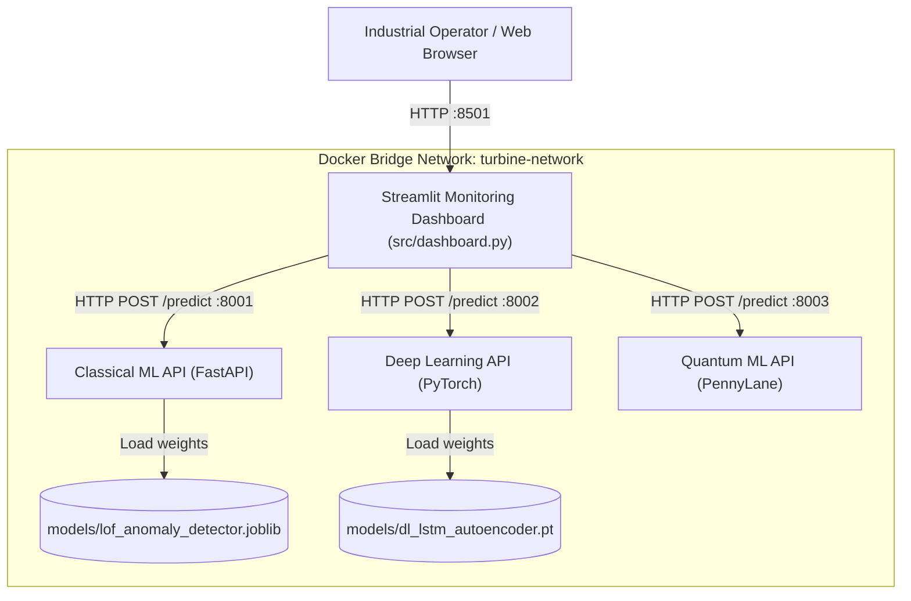

# Wind Turbine Predictive Maintenance System
## Software Engineering (SE) Architecture, Project Walkthrough & Traceability Guide

**Course:** UE24CS341A - Software Engineering  
**Anchors:** Prof. Vadiraja A, Prof. Sheela Devi  
**Project:** Wind Turbine Gearbox Predictive Maintenance System  
**Repository Branch:** `feature/qa-and-mlflow`  
**Target Audience:** Software Engineering Professors, Evaluators, and Peer Engineers  

---

## 1. Project Overview for Beginners ("Explain It To A Friend")

### 1.1 The Real-World Problem
Wind turbines generate clean electricity, but they stand hundreds of feet in the air, often in remote mountain ranges or out in the ocean. The most expensive, high-wear component inside the turbine is the **mechanical gearbox**, which steps up slow blade rotations into high-speed rotations for the electrical generator. 

If a gearbox fails unexpectedly:
- A crane must be booked weeks in advance.
- Repair costs can exceed **\$250,000+** per incident.
- Significant renewable energy generation is lost during downtime.

However, modern wind turbines are equipped with industrial SCADA sensors measuring **temperatures, vibrations, oil pressure, and metallic particle contamination** every 10 minutes. If software can continuously inspect these sensor streams and spot microscopic warning signs days or weeks before a breakdown occurs, technicians can schedule preventive maintenance at a fraction of the cost.

### 1.2 What We Actually Built
We did not just train a machine learning model in a private notebook. We engineered an **enterprise-grade, cloud-native Software Engineering platform**:
1. **Three Independent AI Engines:** Rather than relying on a single model, we built three distinct anomaly detection systems (Classical Machine Learning, Deep Learning, and Quantum Machine Learning).
2. **A "Democratic" Voting System (Consensus Engine):** One AI might occasionally raise a false alarm. To eliminate false alarms, our platform uses an **Ensemble Majority Voting rule ($\ge 2/3$)**—a critical alert is only triggered when at least two independent AI models agree that the turbine is in danger.
3. **Microservices Architecture:** Each AI model runs in its own isolated web server (FastAPI) listening on its own port (`8001`, `8002`, `8003`), mimicking real-world industrial IoT cloud backends.
4. **Interactive Dashboard:** An engineer-friendly web interface (Streamlit on port `8501`) that displays live gauges, time-series telemetry charts, date filters, model toggles, and instant CSV export.
5. **Self-Healing / Fallback Engine:** If any backend microservice is turned off or crashes, the dashboard doesn't crash—it seamlessly switches to local fallback execution mode so maintenance engineers never lose visibility.
6. **Containerization & Automated QA:** Packaged into Docker containers, pre-configured for Kubernetes deployment, and guarded by an automated GitHub Actions CI/CD testing pipeline.

---

## 2. A Guided Tour of the Codebase

Here is how the project files map to software engineering responsibilities:

```
wind-turbine-predictive-maintenance/
├── data/                               # Raw & processed 5-year sensor dataset (262,800 records)
├── models/                             # Serialized trained model weights (.joblib, .pt)
├── src/                                # Core Application Source Code
│   ├── validate_data.py                # Layer 1: Data schema & boundary validation
│   ├── prepare_dataset.py              # Layer 2: Feature engineering (rolling stats & temp diffs)
│   ├── save_lof_model.py               # Layer 3: Model training and serialization
│   ├── predict.py                      # Layer 4: Standalone batch inference
│   ├── dashboard.py                    # Layer 5: Streamlit Web UI & Consensus Orchestrator
│   └── services/                       # Distributed Microservices Tier (FastAPI)
│       ├── ml_service.py               # Port 8001: Classical ML (Isolation Forest / LOF)
│       ├── dl_service.py               # Port 8002: Deep Learning (PyTorch LSTM Autoencoder)
│       └── qml_service.py              # Port 8003: Quantum ML (PennyLane 4-Qubit VQC)
├── tests/                              # Automated Test Suite (15 Test Cases)
│   ├── test_unit.py                    # UT-01 to UT-08: Data, features, and model integrity
│   └── test_microservices.py           # UT-09 to UT-15: REST endpoints, payloads, and edge cases
├── docs/                               # Formal SE Documentation & Verification Reports
│   ├── Updated_Test_Case_Document.md   # Complete test specifications & RTM
│   ├── System_Validation_Report.md     # Black box system test results (SYS-01 to SYS-10)
│   ├── Unit_Test_Report.md             # Automated test execution evidence
│   └── Code_Coverage_Report.md         # Statement & branch coverage analysis
├── .github/workflows/ci.yml            # Automated CI/CD pipeline (Lint, Security Scan, Unit Tests)
├── Dockerfile                          # Multi-stage container definition
└── docker-compose.yml                  # 4-container orchestration with healthchecks
```

---

## 3. The Software Engineering (SE) Perspective

### 3.1 Agile Development Lifecycle (Sprint 1 vs. Sprint 2)
The project followed an iterative Agile Software Development Life Cycle (SDLC):

```mermaid
flowchart LR
    subgraph Sprint 1: Monolithic Foundation
        A1[Sensor Data Ingestion] --> A2[Data Cleaning & Validation]
        A2 --> A3[Feature Engineering Pipeline]
        A3 --> A4[Baseline LOF Model]
        A4 --> A5[Basic Unit Tests]
    end
    
    subgraph Sprint 2: Microservices & Cloud-Native Evolution
        B1[Decouple into 3 REST APIs] --> B2[Deep Learning LSTM Autoencoder]
        B2 --> B3[PennyLane Quantum VQC]
        B3 --> B4[Streamlit Multi-Model Dashboard]
        B4 --> B5[Majority Voting Consensus Engine]
        B5 --> B6[Docker Compose & Kubernetes Deployments]
        B6 --> B7[Automated CI/CD Quality Pipeline]
    end
    
    Sprint 1 --> Sprint 2
```

- **Sprint 1 Focus:** Data pipeline integrity, domain feature engineering (1-hour rolling statistics, thermal gradients), statistical outlier modeling, and foundational validation tests.
- **Sprint 2 Focus:** Modular decomposition from monolith to microservices, implementing multi-paradigm anomaly detectors (PyTorch and PennyLane), containerization, fault-tolerant degraded operation, and automated CI quality gates.

### 3.2 Key Software Engineering Architectural Patterns Used
1. **Microservices Pattern:** Each anomaly engine is encapsulated inside an independent FastAPI service. This decouples technology stacks: scikit-learn runs in `ml_service`, PyTorch tensor computations run in `dl_service`, and PennyLane quantum state-vector simulation runs in `qml_service`.
2. **Facade & Graceful Degradation Pattern:** In [src/dashboard.py](file:///c:/Users/Ananya/Desktop/Eng/Sem5/SE/wind-turbine-predictive-maintenance/src/dashboard.py), the UI talks to a unified client facade. If a microservice is offline, the client catches the connection error and seamlessly falls back to a local in-process inference engine without interrupting the user.
3. **Consensus Decision Pattern:** Rather than trusting a single probabilistic model, the dashboard aggregates predictions from all three microservices. It implements a strict Majority Rule ($\ge 2/3$) to balance false alarms against missed detections.
4. **Data Transformation Pipeline Pattern:** Sensor data flows sequentially through pure, deterministic transforms: `Raw Records` $\rightarrow$ `Validation / Sanitization` $\rightarrow$ `Feature Engineering` $\rightarrow$ `Batch Vectorization` $\rightarrow$ `Inference Output`.

### 3.3 DevOps, Verification & Quality Assurance (QA)
- **Static Code Analysis (Linting):** Enforced via `flake8` against PEP8 standards across all modules.
- **Automated Security Scanning:** Enforced via `bandit` to identify security vulnerabilities, insecure binds, and unhandled network calls.
- **Automated Continuous Integration (CI):** Every `git push` or pull request automatically triggers [.github/workflows/ci.yml](file:///c:/Users/Ananya/Desktop/Eng/Sem5/SE/wind-turbine-predictive-maintenance/.github/workflows/ci.yml) which spins up an Ubuntu environment, installs dependencies, runs static linting, executes the 15-test suite, and verifies Docker image builds.

---

## 4. Requirements Traceability Matrix (RTM)

This matrix maps every **Functional Requirement (FR)** and **Non-Functional Requirement (NFR)** from the SRS directly to the corresponding source code module and test verification case:

| Requirement ID | Requirement Description | Implementation Source Code | Automated Test Case ID & Location |
| :--- | :--- | :--- | :--- |
| **FR-01** | Raw sensor data validation, null checking, and timestamp chronology | [src/validate_data.py](file:///c:/Users/Ananya/Desktop/Eng/Sem5/SE/wind-turbine-predictive-maintenance/src/validate_data.py): `validate_dataset()` | `UT-01`, `UT-02`, `UT-03` in [tests/test_unit.py](file:///c:/Users/Ananya/Desktop/Eng/Sem5/SE/wind-turbine-predictive-maintenance/tests/test_unit.py) |
| **FR-02** | 1-Hour rolling statistics (`mean`, `std`, `min`, `max`) & thermal differential | [src/prepare_dataset.py](file:///c:/Users/Ananya/Desktop/Eng/Sem5/SE/wind-turbine-predictive-maintenance/src/prepare_dataset.py): `compute_rolling_features()` | `UT-04`, `UT-05`, `UT-06` in [tests/test_unit.py](file:///c:/Users/Ananya/Desktop/Eng/Sem5/SE/wind-turbine-predictive-maintenance/tests/test_unit.py) |
| **FR-03** | Model bundle serialization, schema preservation, and score dimension matching | [src/save_lof_model.py](file:///c:/Users/Ananya/Desktop/Eng/Sem5/SE/wind-turbine-predictive-maintenance/src/save_lof_model.py) & [src/predict.py](file:///c:/Users/Ananya/Desktop/Eng/Sem5/SE/wind-turbine-predictive-maintenance/src/predict.py) | `UT-07`, `UT-08` in [tests/test_unit.py](file:///c:/Users/Ananya/Desktop/Eng/Sem5/SE/wind-turbine-predictive-maintenance/tests/test_unit.py) |
| **FR-04** | Classical ML REST API health check and batch anomaly scoring (Port 8001) | [src/services/ml_service.py](file:///c:/Users/Ananya/Desktop/Eng/Sem5/SE/wind-turbine-predictive-maintenance/src/services/ml_service.py): `/health`, `/predict` | `UT-09`, `UT-10`, `UT-11` in [tests/test_microservices.py](file:///c:/Users/Ananya/Desktop/Eng/Sem5/SE/wind-turbine-predictive-maintenance/tests/test_microservices.py) |
| **FR-05** | Deep Learning PyTorch LSTM Autoencoder reconstruction inference (Port 8002) | [src/services/dl_service.py](file:///c:/Users/Ananya/Desktop/Eng/Sem5/SE/wind-turbine-predictive-maintenance/src/services/dl_service.py): `LSTMAutoencoder`, `/predict` | `UT-12`, `UT-13` in [tests/test_microservices.py](file:///c:/Users/Ananya/Desktop/Eng/Sem5/SE/wind-turbine-predictive-maintenance/tests/test_microservices.py) |
| **FR-06** | Quantum ML PennyLane 4-Qubit Variational Classifier circuit execution (Port 8003) | [src/services/qml_service.py](file:///c:/Users/Ananya/Desktop/Eng/Sem5/SE/wind-turbine-predictive-maintenance/src/services/qml_service.py): `quantum_anomaly_circuit()`, `/predict` | `UT-14`, `UT-15` in [tests/test_microservices.py](file:///c:/Users/Ananya/Desktop/Eng/Sem5/SE/wind-turbine-predictive-maintenance/tests/test_microservices.py) |
| **FR-07** | Multi-Model Comparison View & Majority Consensus Voting ($\ge 2/3$) | [src/dashboard.py](file:///c:/Users/Ananya/Desktop/Eng/Sem5/SE/wind-turbine-predictive-maintenance/src/dashboard.py): Lines 240–340 | `SYS-06`, `SYS-07` in [docs/System_Validation_Report.md](file:///c:/Users/Ananya/Desktop/Eng/Sem5/SE/wind-turbine-predictive-maintenance/docs/System_Validation_Report.md) |
| **FR-08** | Dynamic time-series filtering and filtered anomaly CSV export | [src/dashboard.py](file:///c:/Users/Ananya/Desktop/Eng/Sem5/SE/wind-turbine-predictive-maintenance/src/dashboard.py): `st.sidebar.slider`, `st.download_button` | `SYS-02`, `SYS-08` in [docs/System_Validation_Report.md](file:///c:/Users/Ananya/Desktop/Eng/Sem5/SE/wind-turbine-predictive-maintenance/docs/System_Validation_Report.md) |
| **NFR-01** | High-throughput low-latency API response ($\le 500\text{ ms}$) | Vectorized numpy array broadcasting in all 3 services | `test_microservices.py` & Dashboard latency badge |
| **NFR-02** | Fault tolerance and degraded-mode resilience | [src/dashboard.py](file:///c:/Users/Ananya/Desktop/Eng/Sem5/SE/wind-turbine-predictive-maintenance/src/dashboard.py): `fallback_classical_predict`, `fallback_dl_predict`, `fallback_qml_predict` | `SYS-09` in [docs/System_Validation_Report.md](file:///c:/Users/Ananya/Desktop/Eng/Sem5/SE/wind-turbine-predictive-maintenance/docs/System_Validation_Report.md) |
| **NFR-03** | Code maintainability, static styling, and security compliance | Configuration files: [.flake8](file:///c:/Users/Ananya/Desktop/Eng/Sem5/SE/wind-turbine-predictive-maintenance/.flake8), [.bandit](file:///c:/Users/Ananya/Desktop/Eng/Sem5/SE/wind-turbine-predictive-maintenance/.bandit) | CI Pipeline: [.github/workflows/ci.yml](file:///c:/Users/Ananya/Desktop/Eng/Sem5/SE/wind-turbine-predictive-maintenance/.github/workflows/ci.yml) |

---

## 5. System Architecture Design Mapping

This table connects the formal **System Architecture Document** components with their concrete network and deployment counterparts:



| Architecture Tier | Logical Component | Runtime Technology | Physical Port / Endpoint | File Location in Repository |
| :--- | :--- | :--- | :--- | :--- |
| **Presentation Tier** | Monitoring Dashboard | Streamlit, Altair Charts | `http://localhost:8501` | [src/dashboard.py](file:///c:/Users/Ananya/Desktop/Eng/Sem5/SE/wind-turbine-predictive-maintenance/src/dashboard.py) |
| **Service Tier 1** | Classical ML Service | FastAPI, Uvicorn, Scikit-Learn | `http://localhost:8001/predict` | [src/services/ml_service.py](file:///c:/Users/Ananya/Desktop/Eng/Sem5/SE/wind-turbine-predictive-maintenance/src/services/ml_service.py) |
| **Service Tier 2** | Deep Learning Service | FastAPI, Uvicorn, PyTorch LSTM | `http://localhost:8002/predict` | [src/services/dl_service.py](file:///c:/Users/Ananya/Desktop/Eng/Sem5/SE/wind-turbine-predictive-maintenance/src/services/dl_service.py) |
| **Service Tier 3** | Quantum ML Service | FastAPI, Uvicorn, PennyLane VQC | `http://localhost:8003/predict` | [src/services/qml_service.py](file:///c:/Users/Ananya/Desktop/Eng/Sem5/SE/wind-turbine-predictive-maintenance/src/services/qml_service.py) |
| **Model Storage** | DL LSTM Autoencoder Weights | PyTorch Checkpoint Dictionary | Local Filesystem / Disk | [models/dl_lstm_autoencoder.pt](file:///c:/Users/Ananya/Desktop/Eng/Sem5/SE/wind-turbine-predictive-maintenance/models/dl_lstm_autoencoder.pt) |
| **Container Layer** | Multi-Container Composition | Docker Compose v3.8 | Network: `turbine-network` | [docker-compose.yml](file:///c:/Users/Ananya/Desktop/Eng/Sem5/SE/wind-turbine-predictive-maintenance/docker-compose.yml) |
| **Orchestration Layer** | Pod Deployments & Services | Kubernetes Manifests | ClusterIP & Ingress | [k8s/](file:///c:/Users/Ananya/Desktop/Eng/Sem5/SE/wind-turbine-predictive-maintenance/k8s/) directory |
| **DevOps / CI Tier** | Continuous Quality Pipeline | GitHub Actions | Runner: `ubuntu-latest` | [.github/workflows/ci.yml](file:///c:/Users/Ananya/Desktop/Eng/Sem5/SE/wind-turbine-predictive-maintenance/.github/workflows/ci.yml) |

---

## 6. Test Plan & Execution Mapping

Our formal test plan partitions testing into **Unit Tests** (white-box) and **System Tests** (black-box):

### 6.1 Unit Tests (`UT-01` to `UT-15`)
Executed via Python's built-in test framework:
```bash
python -m unittest discover -s tests -p "test_*.py" -v
```

1. **`UT-01` (Chronological Ordering):** Verifies raw timestamps are monotonically ascending.
2. **`UT-02` (Corrupt Timestamp Stripping):** Ensures non-standard or corrupted timestamp strings are dropped.
3. **`UT-03` (Sensor Range Bounds):** Confirms all 7 turbine physical parameter limits are established.
4. **`UT-04` (Rolling Feature Generation):** Verifies mean, std, min, max expansion produces 36 features.
5. **`UT-05` (Rolling Window NaN Behavior):** Validates handling of initial window slices.
6. **`UT-06` (Thermal Gradient Calculation):** Tests $(T_{\text{oil}} - T_{\text{bearing}})$ feature accuracy.
7. **`UT-07` (Model Bundle Integrity):** Asserts model artifact contains dictionary keys `model`, `features`, `threshold`.
8. **`UT-08` (Output Dimension Invariance):** Confirms output prediction length strictly matches input row count.
9. **`UT-09` (ML Health Probe):** Pings `GET http://localhost:8001/health` for HTTP 200.
10. **`UT-10` (ML Inference Scoring):** Tests `POST http://localhost:8001/predict` anomaly classification.
11. **`UT-11` (ML Missing Key Guard):** Verifies HTTP 400 response when features are incomplete.
12. **`UT-12` (DL Health Probe):** Pings `GET http://localhost:8002/health` for PyTorch architecture descriptor.
13. **`UT-13` (DL Reconstruction MSE):** Tests `POST http://localhost:8002/predict` reconstruction error scoring.
14. **`UT-14` (QML Health Probe):** Pings `GET http://localhost:8003/health` for 4-qubit status.
15. **`UT-15` (QML Circuit Execution):** Tests `POST http://localhost:8003/predict` PennyLane Pauli-Z expectation.

### 6.2 System & Integration Tests (`SYS-01` to `SYS-10`)
Documented with empirical evidence in [docs/System_Validation_Report.md](file:///c:/Users/Ananya/Desktop/Eng/Sem5/SE/wind-turbine-predictive-maintenance/docs/System_Validation_Report.md):
- **SYS-01:** Multi-Service Health Badge UI Display (All 3 badges green).
- **SYS-02:** Real-time Time-Series Slider Navigation (smooth chart re-rendering under 500ms).
- **SYS-03, 04, 05:** Single Model Anomaly Identification across ML, DL, and QML.
- **SYS-06:** Triple Model Comparison View (side-by-side metric columns).
- **SYS-07:** Majority Voting Rule Evaluation (alerts triggered if and only if $\ge 2$ models agree).
- **SYS-08:** Filtered CSV Data Export.
- **SYS-09:** Backend Fault-Tolerance / Degraded-Mode Operation (stopping DL container leaves ML & QML active with local fallback).
- **SYS-10:** UI High-Frequency Slider Stress Test (no memory leaks or runtime exceptions).

---

## 7. How to Present this in Your Viva / Defense

When your professor asks you to defend the project and map the documentation to code, use this **3-minute walkthrough script**:

1. **Step 1: The Requirement Foundation (SRS)**
   > *"We structured our project around 8 core functional requirements (FR-01 through FR-08) and 3 non-functional requirements in our SRS document. As shown in our Requirements Traceability Matrix, every requirement maps to a dedicated file in `src/` and a dedicated test in `tests/`."*

2. **Step 2: The Architectural Evolution (Architecture Design)**
   > *"In Sprint 1, we started with a monolithic proof-of-concept. In Sprint 2, following modern Software Engineering principles, we evolved it into a decoupled microservices platform. We have 3 independent AI backends running on ports 8001, 8002, and 8003, coordinated by an interactive Streamlit frontend on port 8501. The services are containerized via Docker Compose and orchestrated with Kubernetes manifests."*

3. **Step 3: The Multi-Model Consensus Innovation**
   > *"Rather than relying on one algorithm which may suffer from false alarms, our dashboard implements an Ensemble Majority Consensus Voting engine. An anomaly is only escalated to a critical alert when at least 2 of the 3 independent algorithms (Classical, Deep Learning, Quantum) reach consensus."*

4. **Step 4: Quality Assurance and Verification (Test Plan)**
   > *"To verify system correctness, we implemented 15 automated unit tests in `tests/test_unit.py` and `tests/test_microservices.py`, which pass in less than 1 second. For system-level validation, we verified 10 end-to-end black box scenarios covering fault-tolerance and degraded-mode operation, which are detailed in our System Validation Report. All code adheres to PEP8 and is guarded by our automated GitHub Actions CI pipeline."*
