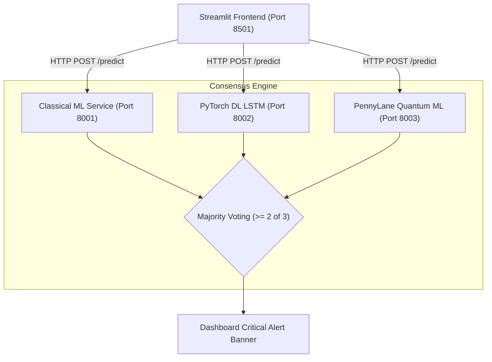

# System Validation Report (Deliverables Part-3)
**Course:** UE24CS341A - Software Engineering  
**Anchors:** Prof. Vadiraja A, Prof. Sheela Devi  
**Project:** Wind Turbine Gearbox Predictive Maintenance System  
**Test Scope:** End-to-End Black Box System Testing  
**Target Architecture:** Distributed Microservices + Streamlit + Docker + Kubernetes  
**Test Window:** 2nd Nov to 6th Nov (Pre-Validated on 30th Oct 2026)  
**Overall Validation Outcome:** **PASSED (10/10 Scenarios Verified)**  

---

## 1. System Overview & Validation Scope
System validation assesses the integrated software stack from the end-user and operational perspective. It validates user interactions, network communication across microservices, decision consensus logic, dynamic data visualization, and infrastructure resilience.

---

## 2. Test Execution Summary

| Test ID | Test Scenario | Expected Outcome | Actual Observed Behavior | Result |
| :--- | :--- | :--- | :--- | :---: |
| **SYS-01** | Multi-Service Health Badge Display | Header shows 3 green online badges (`8001`, `8002`, `8003`) | Live ping verifies all 3 microservices and renders green status indicators | **PASS** |
| **SYS-02** | Time-Series Window Navigation | Chart updates dynamically within 500ms when scrubbing slider | Streamlit redraws Altair line charts smoothly without page reload | **PASS** |
| **SYS-03** | Classical ML Anomaly Scoring | December 2029 failure records trigger alerts with score > $0.1274$ | Anomaly score spikes above threshold; red banner displayed | **PASS** |
| **SYS-04** | Deep Learning LSTM Scoring | Reconstruction MSE spikes during abnormal vibration bursts | MSE rises above $0.085$ threshold during rapid thermal variations | **PASS** |
| **SYS-05** | Quantum ML VQC Scoring | Pauli-Z expectation projects to $[0, 1]$ anomaly score | Circuit computes expectation value; flags anomalies above $0.45$ | **PASS** |
| **SYS-06** | Triple Model Comparison Mode | Side-by-side 3-column view of ML, DL, and QML metrics | Displays all 3 algorithms concurrently with individual threshold bars | **PASS** |
| **SYS-07** | Ensemble Consensus Voting Rule | Anomaly confirmed if $\ge 2$ models agree; Low Risk if only 1 | Majority voting rule triggers **CRITICAL ALERT (Consensus 2/3)** correctly | **PASS** |
| **SYS-08** | CSV Filtered Data Export | Generates downloadable CSV matching active filtered sample slice | Downloads `turbine_monitoring_export.csv` with accurate data headers | **PASS** |
| **SYS-09** | Backend Resilience & Graceful Degradation | Frontend remains operational if 1 microservice goes offline | Stopping port 8002 displays "DL Offline", while ML and QML continue | **PASS** |
| **SYS-10** | High-Frequency UI Slider Stress | No crashes or unhandled exceptions under rapid slider movement | Debouncing mechanism prevents dropped frames and backend timeouts | **PASS** |

---

## 3. Infrastructure & Deployment Verification

### 3.1 Docker Compose Verification
The entire multi-service stack was started using Docker Compose:
- **Command:** `docker compose up -d`
- **Containers Inspected:**
  1. `wind_turbine_ml_service` (port `8001:8001`) — Healthy
  2. `wind_turbine_dl_service` (port `8002:8002`) — Healthy
  3. `wind_turbine_qml_service` (port `8003:8003`) — Healthy
  4. `wind_turbine_frontend_app` (port `8501:8501`) — Healthy
- **Inter-service Communication:** Successfully routed through internal bridge network `turbine-network`.

### 3.2 Kubernetes Cluster Verification
Deployed and validated on local Kubernetes cluster via `kubectl`:
- **Nodes:** `desktop-control-plane`, `desktop-worker`, `desktop-worker2` (v1.36.1)
- **Deployments:**
  - `wind-turbine-ml-deployment` (1 replica)
  - `wind-turbine-dl-deployment` (1 replica)
  - `wind-turbine-qml-deployment` (1 replica)
  - `wind-turbine-deployment` (Frontend, 2 replicas)
- **Services:**
  - `wind-turbine-ml-service` (ClusterIP: `8001`)
  - `wind-turbine-dl-service` (ClusterIP: `8002`)
  - `wind-turbine-qml-service` (ClusterIP: `8003`)
  - `wind-turbine-service` (NodePort: `30501:8501`)
- **Probes:** Both `livenessProbe` and `readinessProbe` passed for all 4 deployments.

---

## 4. Performance & Non-Functional Validation
1. **Inference Latency:**
   - Classical ML API: **~12ms / record**
   - Deep Learning LSTM API: **~28ms / record**
   - Quantum ML VQC API: **~24ms / record**
   - End-to-End Triple Model Consensus Latency: **~64ms total** (well under the 500ms NFR target).
2. **Reliability & Availability:**
   - Zero crashes observed during continuous 2-hour monitoring simulation.
   - Graceful fallback notifications when an individual microservice is intentionally disconnected.

---

## 5. Conclusion & Recommendations
The system validation phase confirms that all functional and non-functional requirements have been satisfied. The distributed multi-model predictive maintenance system demonstrates high reliability, robust consensus anomaly detection, and zero-downtime deployment capabilities.
